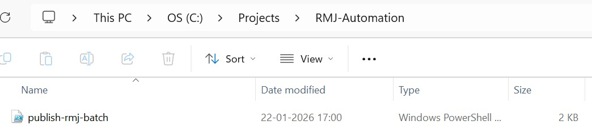
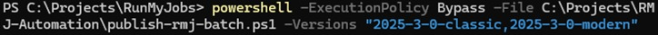
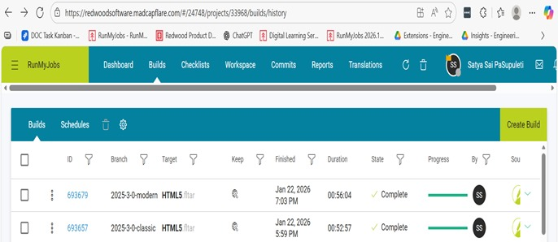

!!! abstract "About this sample"
    - **What this is** A case study from my work at Redwood Software. I automated the publishing of the RunMyJobs (RMJ) documentation across multiple product versions without changing the existing build process.
    - **Audience** Documentation teams, documentation managers and engineering stakeholders.
    - **Tools used** MadCap Flare, MadCap Flare Online, Git, PowerShell.
    - **What it demonstrates** Ownership of the documentation lifecycle beyond writing: finding the real bottleneck, working within platform constraints, and turning a manual release task into a repeatable workflow.
    - **My role** I took this on outside my role as Senior Technical Writer: I spotted the bottleneck, designed the workflow and built the tool myself.

# Automated RMJ documentation publishing pipeline

Reducing manual publishing effort while preserving the existing RMJ build process.

## Problem

### Context and constraints

RMJ documentation supports multiple product versions and UI variants, each on a separate Git branch. A required post-build script must run after every MadCap Flare build, and it can't run from MadCap Central.

That means publishing has to be driven locally. The goal was to automate within these constraints, not bypass them.

### Why the obvious solutions failed

MadCap Central couldn't run the post-build script. Build speed wasn't the issue; manual orchestration was. Publishing 10 or more versions meant hours of switching branches, triggering builds, waiting and verifying.

## Insight

The problem wasn't how builds worked. It was the repetitive manual orchestration around them. Each branch could be processed independently, which preserves version isolation and the existing build logic.

## Solution

### Designing a safe automation workflow

The automation wraps around the existing process without modifying the Flare configuration or the post-build script. It processes branches one after another (checkout, build, post-process, publish), so it behaves exactly like manual publishing without the manual steps.

*The batch automation lives outside the RMJ repository, so switching branches never touches it.*

### Execution in practice

A single PowerShell command takes a list of branches and processes each one independently. No one needs to intervene while it runs.

*One command triggers sequential publishing across multiple RMJ versions.*

### Verification and trust

Each publish produces a separate, verifiable build in Flare Online, identical to a manual publish. The automation is transparent: it removes effort without hiding what happens.

*Independent build IDs in Flare Online confirm that each version stays isolated.*

## Result

- Manual effort dropped from hours to minutes of setup.
- Publishing 10–15 versions became practical and repeatable.
- The workflow scales linearly without adding complexity.
- Publishing moved from a repetitive task to a controlled, reliable workflow.

## My role

Nobody asked for this tool. Publishing was part of my work as Senior Technical Writer on RunMyJobs, but fixing the process wasn't. I spotted the bottleneck, designed the workflow and built the tool myself, and the existing Flare configuration and post-build script stayed exactly as they were.
