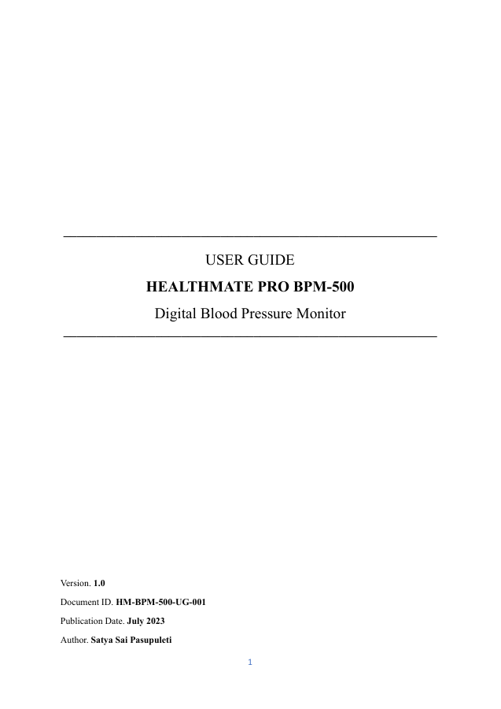

!!! abstract "About this sample"
    - **What this is** A 19-page user guide for the HealthMate Pro BPM-500, a fictional digital blood pressure monitor.
    - **Audience** Patients and caregivers who use the device at home.
    - **Tools used** Microsoft Word, PDF.
    - **What it demonstrates** Regulated-domain documentation: safety messaging by severity, task-based operating steps, troubleshooting, and the warranty and regulatory content a medical device ships with.
    - **Note** HealthMate is a fictional brand created for this sample.

# HealthMate Pro BPM-500 user guide

[Open the PDF](../assets/downloads/healthmate-bpm-500-user-guide.pdf){ .md-button target="_blank" }

{ .sp-cover }

## What's inside

| Section | What it covers |
|---|---|
| Safety information | Warnings, cautions and recommendations, separated by severity |
| Introduction | Product overview, key features, intended use, device overview and cuff position |
| Package contents and symbols | What's in the box and what each marking means |
| Operating instructions | Preparing the device, applying the cuff, taking and reading a measurement, storing readings and powering off |
| Troubleshooting | Common problems and how to fix them |
| Maintenance and care | Cleaning, storage, periodic checks and disposal |
| Specifications, warranty and support | Technical specifications, warranty coverage and customer support |
| Regulatory and compliance | Regulatory statements, device classification and manufacturer's declaration |
| Glossary | Terms a non-clinical reader may not know |

## Writing decisions

- **Safety first, by severity.** Warnings (risk of injury), cautions (risk of damage or inaccurate readings) and recommendations are separate, so readers know how seriously to take each one.
- **One task per section.** Operating instructions follow the order a person actually uses the device, from preparation to storage.
- **Written for a non-clinical reader.** A glossary covers terms a patient or caregiver may not know.
