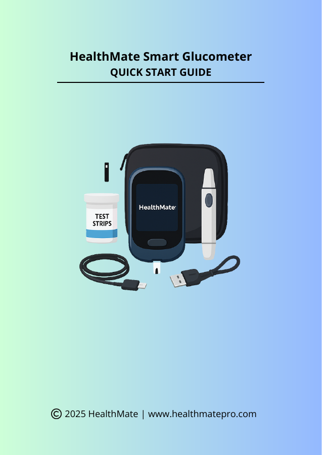

!!! abstract "About this sample"
    - **What this is** A three-page quick start guide for the HealthMate smart glucometer, a fictional connected medical device.
    - **Audience** First-time users testing their blood glucose at home.
    - **Tools used** Canva, PDF.
    - **What it demonstrates** How much to leave out: only what a first-time user needs to take a safe, accurate reading, with a pointer to medical advice.
    - **Note** HealthMate is a fictional brand created for this sample.

# HealthMate smart glucometer quick start

[Open the PDF](../assets/downloads/healthmate-glucometer-quick-start.pdf){ .md-button target="_blank" }

{ .sp-cover }

## What's inside

| Section | What it covers |
|---|---|
| What's in the box | Device, test strips, lancets, charging cable and case |
| Before you begin | Charging, pairing with the app over Bluetooth, and hand hygiene |
| Using the device | Four steps from inserting a strip to reading the result |
| Understanding your results | Normal, high and low ranges, and when to consult a doctor |
| Safety and maintenance | Cleaning, storage and lancet safety |
| Troubleshooting | Error codes and what to do |
