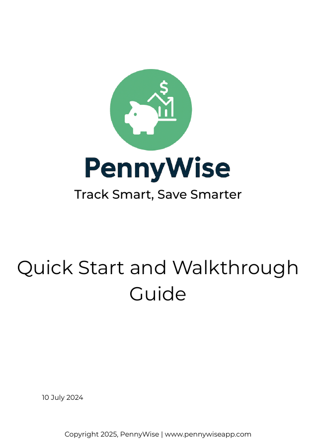

!!! abstract "About this sample"
    - **What this is** A six-page quick start and walkthrough guide for PennyWise, a fictional budgeting app.
    - **Audience** New users, including students, families and anyone new to budgeting.
    - **Tools used** Canva, PDF.
    - **What it demonstrates** Consumer onboarding: a five-step setup, task walkthroughs for the main features, and FAQs that answer the questions new users ask before they trust an app with their money.
    - **Note** PennyWise is a fictional product created for this sample.

# PennyWise quick start and walkthrough

[Open the PDF](../assets/downloads/pennywise-quick-start-guide.pdf){ .md-button target="_blank" }

{ .sp-cover }

## What's inside

| Section | What it covers |
|---|---|
| Getting started | What PennyWise is, key features and who it's for |
| Quick setup | Five steps from download to the first budget |
| Key features | Using the dashboard, logging a transaction and creating a savings goal |
| FAQs | Cost, using the app without a bank link, data security, exports and currencies |
| Need help? | Support channels and a security notice |
